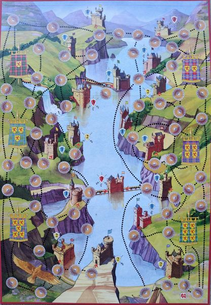

# hrady

Reference material for the board game **Hrady** — also published as
**Highlanders** (Jumbo, 1993) and **Rheingold** — designed by Reinhard Herbert.
3–5 players fight over 18 castles along the Rhine.

## Contents

- [`docs/map.jpg`](docs/map.jpg) — photo of the game board
- [`docs/rules.md`](docs/rules.md) — English rules (translation by Walt Mulder, 2007)
- [`docs/PLAN.md`](docs/PLAN.md) — staged implementation plan
- [`docs/Rheingold_rules.doc`](docs/Rheingold_rules.doc) — the original Word file of that translation

