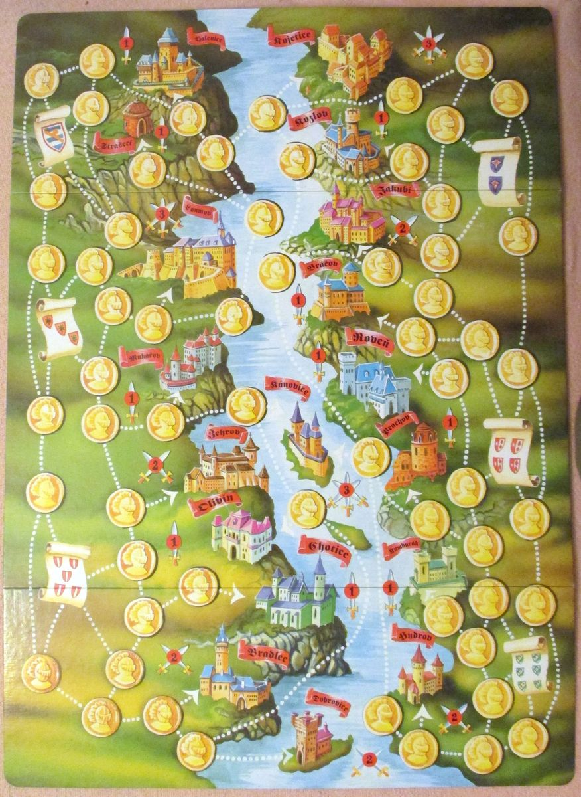

# hrady

Reference material for the board game **Hrady** — also published as
**Highlanders** (Jumbo, 1993) and **Rheingold** — designed by Reinhard Herbert.
3–5 players fight over 18 castles along the Rhine.

This repo is a web app to play it against AI and human opponents; see
[`docs/PLAN.md`](docs/PLAN.md) for the architecture and stages.

## Development

Requires Node 22+ and pnpm 10.

```sh
pnpm install
pnpm lint          # ESLint + Prettier check
pnpm typecheck     # tsc in every package
pnpm test          # Vitest

pnpm dev:web         # game client (apps/web); /debug.html is the 2D debug client
pnpm dev:server      # game server: Worker + Durable Object via wrangler dev (apps/server)
pnpm dev:map-editor  # board tracing tool (tools/map-editor)
pnpm tournament --lineup heuristic,random,random --games 100  # bot-vs-bot (packages/ai)
```

| Path                | What                                                        |
| ------------------- | ----------------------------------------------------------- |
| `packages/board`    | board graph (`hrady.json`), types, loader, validation       |
| `packages/engine`   | pure, deterministic rules engine                            |
| `packages/ai`       | bots (random, heuristic, Monte-Carlo) and tournaments       |
| `packages/protocol` | client/server messages for online play and validation       |
| `apps/web`          | pixel-art game client, 2D debug client (`debug.html`)       |
| `apps/server`       | online rooms: Cloudflare Worker + `GameRoom` Durable Object |
| `tools/map-editor`  | click-to-trace editor over the board photo (not shipped)    |

Every push to `main` builds `apps/web` and publishes it on GitHub Pages
(`.github/workflows/pages.yml`): the game at the root, the 2D debug client
at `debug.html`.

### Online play

_Online_ in the game client creates a room (3–5 players) or joins one by code;
the host adds Easy/Medium/Hard bots, which run in the host's browser. The
server ([`apps/server`](apps/server/README.md)) is authoritative and sends
each player only their own view. With both dev servers running, the client
finds the local server at port 8787 by itself:

```sh
pnpm dev:server & pnpm dev:web     # then open http://localhost:5173 in a few windows
node apps/web/scripts/online-e2e.mjs   # a whole game in several Playwright browsers
```

Deploy the server with `pnpm --filter @hrady/server run deploy` after `npx wrangler
login` (free plan; it prints the `https://hrady.<account>.workers.dev` URL),
then set the repository variable `HRADY_SERVER_URL` to that URL so the Pages
build (`VITE_SERVER_URL`) points the published client at it. Without it the
published client plays locally only.

## Contents

- [`docs/board/board-full.jpg`](docs/board/board-full.jpg) — full board, Czech _Hrady_ edition (main reference)
- [`docs/board/board-closeup.jpg`](docs/board/board-closeup.jpg) — close-up of the board
- [`docs/map.jpg`](docs/map.jpg) — older low-res photo of the board
- [`docs/KICKOFF_PROMPT.md`](docs/KICKOFF_PROMPT.md) — prompt to start development in a new session
- [`docs/rules.md`](docs/rules.md) — English rules (translation by Walt Mulder, 2007)
- [`docs/PLAN.md`](docs/PLAN.md) — staged implementation plan
- [`docs/Rheingold_rules.doc`](docs/Rheingold_rules.doc) — the original Word file of that translation


